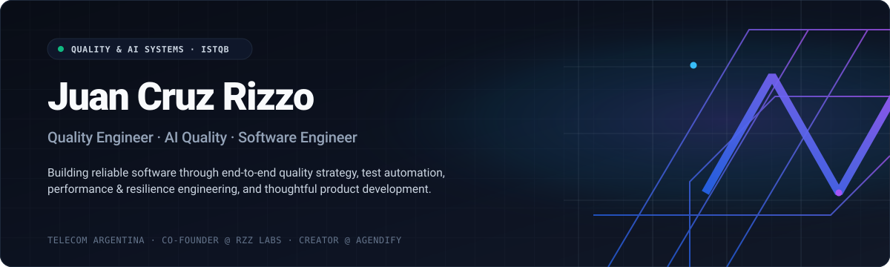
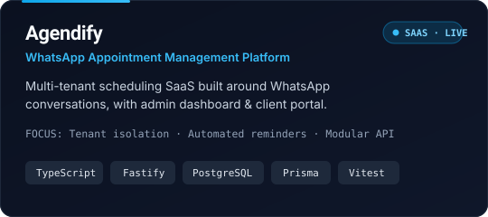
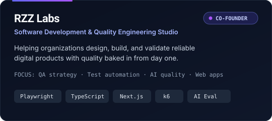
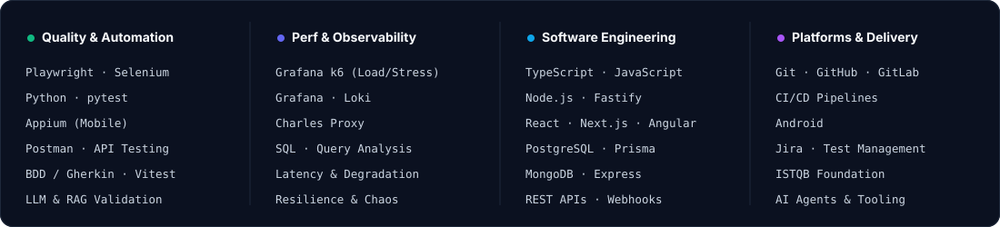

<!--
  Juan Cruz Rizzo — GitHub Profile
  Focus: Quality Engineering, AI Quality, Test Automation & Software Engineering
-->

  

  
  
  
  

---

## About

I work at the intersection of **Quality Engineering, software development, and AI-powered products**. My approach is to understand systems end to end — from requirements and APIs to integrations, performance, resilience, and user experience.

I turn complex technical problems into reliable, maintainable solutions, whether that means designing a testing strategy, automating a critical workflow, investigating system behavior under load, or shipping a product.

---

## Engineering Focus

| Area | What I Work On |
|---|---|
| **Quality Engineering** | Test strategy, functional and non-functional testing, risk analysis, exploratory testing, and defect investigation |
| **AI Quality Engineering** | LLM application validation, streaming responses, tool calling, agents, RAG workflows, guardrails, and fallback behavior |
| **Test Automation** | End-to-end and API automation, BDD/Gherkin, maintainable test suites, and CI/CD integration |
| **Performance & Resilience** | Load and stress testing, latency profiling, network degradation, and system reliability |
| **Software Engineering** | Web applications, APIs, integrations, and internal engineering tooling |
| **Observability** | Metrics, logs, dashboards, and evidence-driven technical investigation |

---

## Selected Projects

  
  

- **[Agendify](https://agendify.me)** (`WA-CALENDAR-IABOT`) — Multi-tenant scheduling platform built around WhatsApp conversations, featuring tenant data isolation, automated reminders, an admin dashboard, and a client portal.
- **[RZZ Labs](https://rzzlabs.com)** (`rzz-labs-website`) — Co-founded studio focused on helping organizations design, build, and validate reliable digital products through Quality Engineering, test automation, and AI quality initiatives.
- **[Madame Pastel](https://github.com/jcrizzo89/Madame-Pastel-Frontend)** — E-commerce web application for a bakery (`React · Node.js · Express · MongoDB`) with product catalog, shopping cart, administration panel, and WhatsApp-based order requests.

---

## Engineering Toolkit

  

Tools listed represent a mix of professional use, personal projects, and ongoing learning; they do not imply the same depth of experience in every technology.

---

## How I Approach Engineering

1. **Understand the problem** — clarify business goals, requirements, constraints, and acceptance criteria.
2. **Identify risk early** — explore critical paths, integrations, edge cases, and failure scenarios.
3. **Design for quality** — choose appropriate test levels, coverage, and validation techniques.
4. **Automate with purpose** — prioritize repeatability, maintainability, and fast, useful feedback.
5. **Measure behavior** — use performance signals, logs, and metrics to investigate system health.
6. **Improve continuously** — communicate findings clearly and turn evidence into actionable improvements.

---

## Experience & Certification

**QA Manual, Performance & Resilience Analyst — Telecom Argentina**  
Focused on software quality, performance, resilience, API validation, and application behavior under variable conditions. Additional work includes AI quality initiatives, QA process design, and test automation.

Professional examples are intentionally described at a high level to respect confidentiality. They are not presented as RZZ Labs client projects or as an endorsement by an employer.

**ISTQB Certified Tester — Foundation Level** · June 2023

---

## Let's Connect

- **Recruiters & Engineering Teams:** Open to discussions around Quality Engineering, AI Quality, Test Automation, Performance, and Software Engineering.
- **Founders & Businesses:** Reach out via [RZZ Labs](https://rzzlabs.com) to discuss software development and Quality Engineering.
- **Product:** Explore [Agendify](https://agendify.me).

  <a href="https://github.com/jcrizzo89">GitHub</a> ·
  <a href="https://www.linkedin.com/in/juancruzrizzo/">LinkedIn</a> ·
  <a href="https://rzzlabs.com">RZZ Labs</a> ·
  <a href="https://agendify.me">Agendify</a> ·
  <a href="mailto:rzzlabs.admin@gmail.com">Email</a>

